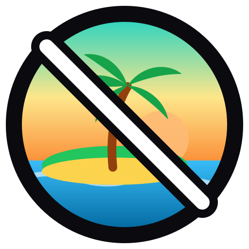
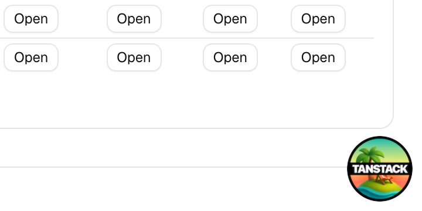
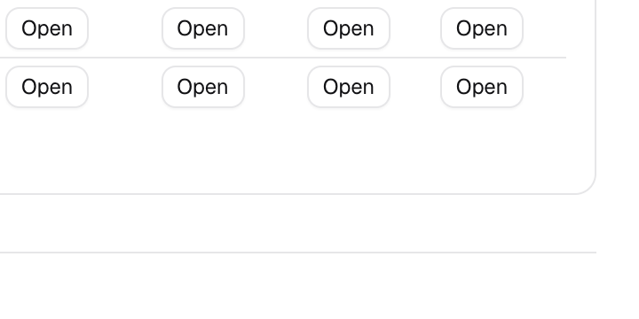
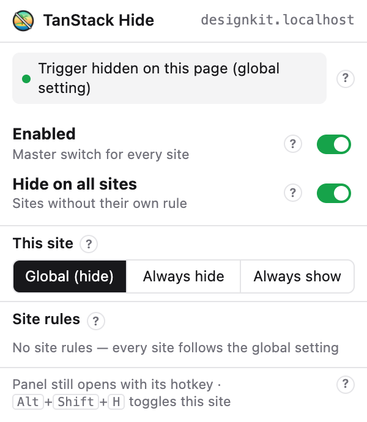
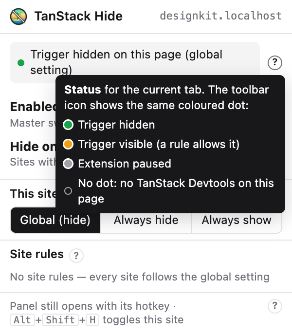
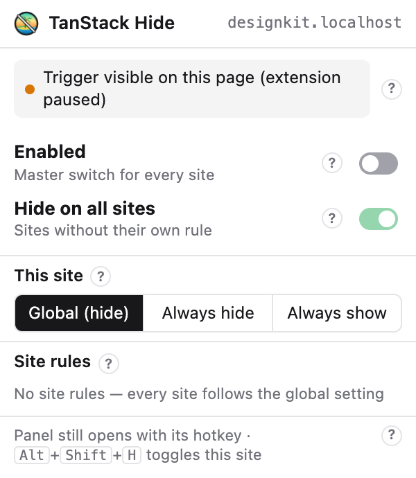
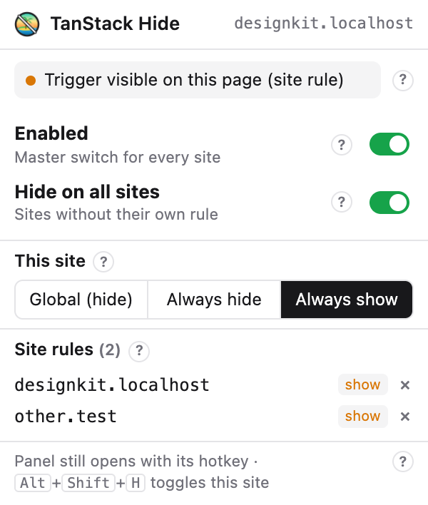

<h1 align="center">tanstack-hide</h1>

<strong>Hide the TanStack Devtools corner button.</strong>

A free, open-source Chrome extension that hides the floating TanStack Devtools trigger on every project at once, or per site, while the devtools panel stays one hotkey away.

  
  
  
  
  

  
  
   <em>Left: the TanStack Devtools button sitting on top of the app. Right: with the extension.</em>

tanstack-hide is a Manifest V3 Chrome extension for developers building with TanStack Router, TanStack Query, TanStack Start or any app that mounts TanStack Devtools. It hides the floating devtools trigger button globally or per site (host and port), shows the state as a coloured dot on the toolbar icon, syncs your rules with Chrome sync, and makes no network requests. The devtools panel itself is untouched and still opens with its hotkey.

## Contents

- [Why tanstack-hide?](#why-tanstack-hide)
- [Features](#features)
- [Install](#install)
- [Quick start](#quick-start)
- [The popup, control by control](#the-popup-control-by-control)
- [The toolbar status dot](#the-toolbar-status-dot)
- [Keyboard shortcut](#keyboard-shortcut)
- [How a site's setting is decided](#how-a-sites-setting-is-decided)
- [Use cases](#use-cases)
- [Privacy and permissions](#privacy-and-permissions)
- [Troubleshooting](#troubleshooting)
- [FAQ](#faq)
- [Development](#development)
- [How it works](#how-it-works)
- [License](#license)

## Why tanstack-hide?

TanStack Devtools puts a round floating button in a corner of every page in development. It sits on top of your own UI, covers buttons and footers, and shows up in every screenshot, screen recording and demo. The devtools do have their own "Hide trigger" settings, but they are saved in each app's `localStorage` (key `tanstack_devtools_settings`), which is per origin: you set them again for every project, every port and every browser profile, and they are gone whenever site data is cleared.

tanstack-hide moves that decision out of each app and into your browser. Set it once and every project is clean, with exceptions where you want the button.

- **One switch for every project, port and profile**, instead of one setting per origin.
- **Per-site exceptions**: Always show on the app you are debugging, Always hide on the one where it gets in the way.
- **The panel keeps working**: only the button is hidden, so the devtools hotkey still opens everything.
- **No flash**: the button is hidden by CSS before any script runs.
- **Status at a glance**: a coloured dot on the toolbar icon says hidden, visible or paused.
- **Nothing to change in your code**, and nothing that affects teammates.
- **Private**: no network requests, settings stay in your Chrome profile.

| | **tanstack-hide** | Devtools' own "Hide trigger" setting | Custom CSS in each app | Removing the devtools component |
|---|---|---|---|---|
| Set once for every project and port | ✅ | ❌ per origin | ❌ per app | ❌ per app |
| Devtools panel still opens by hotkey | ✅ | ✅ | ✅ | ❌ |
| Per-site exceptions | ✅ | ⚠️ set in each app | ⚠️ edit each app | ⚠️ edit each app |
| Survives clearing site data | ✅ | ❌ | ✅ | ✅ |
| No change to your app's code | ✅ | ✅ | ❌ | ❌ |
| Leaves teammates' setup alone | ✅ | ✅ | ❌ committed | ❌ committed |
| Shows the state at a glance | ✅ | ❌ | ❌ | ❌ |

If you only work on one app, the devtools' own setting is enough. If you jump between several TanStack projects, ports and profiles, that is what tanstack-hide is for.

## Features

- **Hidden by default** on every site, with no flash of the button while the page loads.
- **Master switch** to pause the extension everywhere without losing your rules.
- **Global default** ("Hide on all sites") for any site without its own rule.
- **Per-site rules**: Global, Always hide or Always show, keyed by host and port, so `localhost:3000` and `localhost:5173` are separate apps.
- **Site rules list** in the popup, with one-click removal.
- **Status dot** on the toolbar icon: green = hidden, amber = visible by a rule, grey = paused, no dot = no TanStack Devtools on the page.
- **Shortcut** <kbd>Alt</kbd>+<kbd>Shift</kbd>+<kbd>H</kbd> flips the current site.
- **Help popover** (`?`) on every control in the popup.
- **Live**: changes apply to open tabs instantly, no reload.
- **Synced** across your Chrome profile with Chrome sync.
- **Light and dark** popup, following your system theme.

## Install

1. Clone the repo: `git clone https://github.com/khanakia/tanstack-hide.git`
2. Open `chrome://extensions` and turn on **Developer mode** (top right).
3. Click **Load unpacked** and pick the cloned folder.
4. Pin the extension: click the puzzle icon in the toolbar, then the pin next to **TanStack Devtools Trigger Hide**, so its status dot is always in view.
5. Reload any tab that was already open. Tabs opened before the install do not have the extension yet.

To update later: `git pull`, then click the reload icon on the extension's card in `chrome://extensions`, then reload your tabs.

It should also work in other Chromium browsers that load unpacked extensions (Edge, Brave, Vivaldi, Opera, Arc); only Chrome is tested.

## Quick start

Nothing to configure: after installing, the button is hidden on every site. Open your app and the corner is clear.

To bring the devtools up, use their own hotkey. It is shown in the devtools settings and is <kbd>Ctrl</kbd>+<kbd>~</kbd> by default. The panel opens and closes exactly as before; only the floating button is gone.

Click the toolbar icon to open the popup and change anything below.

## The popup, control by control

Every control in the popup has a `?` next to it. Hover it, focus it with <kbd>Tab</kbd>, or click it to read what that control does.

### Header

Shows the site in the current tab, as host and port (for example `designkit.localhost` or `localhost:3000`). Rules you set under **This site** apply to exactly this value.

### Status line

Tells you what is happening in the current tab, and why:

| Status | Meaning |
|---|---|
| **Trigger hidden on this page (global setting)** | The button is on the page and hidden, because "Hide on all sites" is on and this site has no rule. |
| **Trigger hidden on this page (site rule)** | Hidden because this site is set to **Always hide**. |
| **Trigger visible on this page (site rule)** | Shown because this site is set to **Always show**. |
| **Trigger visible on this page (extension paused)** | Shown because **Enabled** is off. |
| **No TanStack Devtools on this page** | The page has no devtools button. It also says what would happen if one appeared. |
| **Reload the page to apply** | The tab was open before the extension was installed or updated. Reload it. |
| **Not available on this page** | Chrome does not let extensions run here (`chrome://` pages, the Chrome Web Store, the new tab page). |

### Enabled

The master switch. Turn it off to pause the extension: the button shows on **every** site, and the global setting and all site rules are ignored. Your rules are kept, and come back when you turn it on again.

### Hide on all sites

The default for every site that has no rule of its own.

- **On** (default): hide the button everywhere, except on sites set to **Always show**.
- **Off**: leave the button visible everywhere, and hide it only on sites set to **Always hide**.

### This site

A rule for the site in the current tab:

- **Global**: no rule; follow "Hide on all sites". The button label tells you which way that currently goes, for example "Global (hide)".
- **Always hide**: hide the button on this site, even when "Hide on all sites" is off.
- **Always show**: keep the button on this site, even when "Hide on all sites" is on.

Rules match host and port exactly. `localhost:3000` and `localhost:5173` are two different sites, and `app.example.com` is a different site from `example.com`.

### Site rules

Every site that has its own rule, with what the rule is (`hide` or `show`). Click **×** to remove a rule; that site goes back to following "Hide on all sites".

## The toolbar status dot

The toolbar icon shows the state of the current tab at a glance:

| Icon | Meaning |
|---|---|
| Plain icon, no dot | No TanStack Devtools on this page (or Chrome does not allow extensions here). |
| Green dot | The button is on the page and hidden. |
| Amber dot | The button is on the page and visible, because a site rule or "Hide on all sites: off" allows it. |
| Grey dot | The extension is paused (Enabled is off), so the button is visible. |

Hover the icon to see the same status as text, with the site name.

## Keyboard shortcut

<kbd>Alt</kbd>+<kbd>Shift</kbd>+<kbd>H</kbd> flips the current site: if the button is hidden there it becomes **Always show**, and if it is visible it becomes **Always hide**. If the extension is paused, the shortcut also turns it back on, because hiding while paused would do nothing.

To change the shortcut, or if it does nothing because another extension already uses it, go to `chrome://extensions/shortcuts` and set a new one for **Toggle hiding on the current site**.

This shortcut belongs to the extension. The devtools panel has its own hotkey (<kbd>Ctrl</kbd>+<kbd>~</kbd> by default), which the extension does not touch.

## How a site's setting is decided

For each page, the first matching line wins:

| Order | Condition | Result |
|---|---|---|
| 1 | **Enabled** is off | Button visible |
| 2 | This site is set to **Always hide** | Button hidden |
| 3 | This site is set to **Always show** | Button visible |
| 4 | **Hide on all sites** is on | Button hidden |
| 5 | Otherwise | Button visible |

## Use cases

**Hide it everywhere, always.** Install and you are done. This is the default.

**Keep it on the one app you are debugging.** You are working on the Query cache in one project and want the button there. Open that app, click the icon, choose **Always show**. Every other project stays clean.

**Hide it only on certain apps.** You like the button in general but not on one app where it covers a footer or a floating chat widget. Turn **Hide on all sites** off, then set that app to **Always hide**.

**Screenshots, screen recordings and demos.** Leave the extension on and the button never appears in your captures. If a demo needs the devtools, press their hotkey to open the panel and close it again, without the button ever showing.

**Pair programming and client calls.** Share your screen with a clean UI. If you need to look at devtools mid-call, open the panel with its hotkey.

**Visual review and design QA.** Compare pages against designs without a badge covering the bottom-right corner, where cookie banners, toasts and chat buttons usually live.

**Several apps on different ports.** A Router app on `localhost:3000`, a Start app on `localhost:5173` and a Storybook on `localhost:6006` each get their own rule, because rules are per host and port.

**Check for a moment, then put it back.** Turn **Enabled** off to see the button everywhere, then on again. Your rules stay as they were.

**A flip without opening the popup.** <kbd>Alt</kbd>+<kbd>Shift</kbd>+<kbd>H</kbd> on the current tab.

**The same setup on every machine.** Settings are stored with Chrome sync, so the same rules follow you to every Chrome where you are signed in with sync turned on.

## Privacy and permissions

The extension makes no network requests, has no analytics and collects nothing. Its settings (the switches and your list of site hosts) are stored in `chrome.storage.sync`, so Chrome syncs them to your own profile.

| Permission | Why it is needed |
|---|---|
| Content script on all sites | To find the devtools button on a page and hide it. It adds one CSS rule and a class on `<html>`, and reads nothing else from the page. |
| `storage` | To save your settings. |
| `activeTab` | To read the current tab's address when you open the popup or press the shortcut, and only then. The extension does not ask for access to your browsing history. |

## Troubleshooting

**The button still shows after installing or updating.** Reload the tab. Pages opened before the install or update do not have the new version.

**The popup says "Reload the page to apply".** Same cause; reload the tab.

**There is no dot, but the page does show the button.** The extension looks for TanStack Devtools' own button (`button[aria-label="Open TanStack Devtools"]` inside `[data-testid="tanstack_devtools"]`). A different devtools build that renders other markup will not match. Open an issue with the button's HTML.

**The button is hidden, but so is something I need.** Only that exact button is hidden. If something else disappeared, set the site to **Always show** to confirm the extension is the cause, then open an issue.

**The shortcut does nothing.** Another extension or app may already use <kbd>Alt</kbd>+<kbd>Shift</kbd>+<kbd>H</kbd>. Set a different one at `chrome://extensions/shortcuts`.

**I see an old "SHOW" or "HID" label on the icon.** Version 1.1 used text badges. The current version clears them the next time the tab updates; reload the tab if one stays.

**It does not work on `chrome://` pages or the Chrome Web Store.** Chrome does not allow extensions there.

**Settings did not reach my other computer.** Chrome sync must be on for extensions in that profile (`chrome://settings/syncSetup`).

## FAQ

**Does this disable TanStack Devtools?** No. Only the floating button is hidden. The panel and all of its plugins work as before, through the devtools hotkey.

**Does it affect production?** TanStack Devtools normally only renders in development, so the extension has nothing to do in production builds.

**How is this different from the devtools' own "Hide trigger" setting?** The built-in setting is stored per app in that app's local storage, so you set it for every project, port and profile, and it resets when storage is cleared. The extension sets it once for all of them, with per-site exceptions.

**Does it slow pages down?** Not noticeably. It adds one CSS rule, plus a page observer that only checks for the button and stops once it has found it. On pages that never render TanStack Devtools the observer stays on, doing that one check per DOM change.

**Does it work inside iframes?** Yes, the button is hidden in iframes too. The status dot and the popup describe the top-level page.

**Does it hide the older React Query Devtools button too?** No. It targets the unified TanStack Devtools (`@tanstack/devtools`, used by `@tanstack/react-devtools` and the TanStack Start templates), whose trigger is a button labelled "Open TanStack Devtools". The standalone `@tanstack/react-query-devtools` floating logo renders different markup and is not matched yet.

**Is it on the Chrome Web Store?** Not yet. Install it unpacked from this repo (see [Install](#install)); `task zip` builds the package for a store upload.

**Is this an official TanStack project?** No. It is an independent extension, not affiliated with TanStack. The logo is original artwork, not the TanStack logo.

## Development

Commands live in `Taskfile.yml` ([Task](https://taskfile.dev)):

| Task | What it does |
|---|---|
| `task test` | End-to-end test of the real extension in headless Chrome for Testing: every setting combination, the toolbar status, the popup controls and the help popovers. Set `E2E_URL` to a page that renders TanStack Devtools. Output goes to `.e2e/`. |
| `task screenshots` | Run the test and save the README screenshots to `docs/screenshots/`. |
| `task brand` | Regenerate the brand kit in `brand/` from `brand/gen-brand.mjs` and `brand/brand.json`, then the extension icons. See [brand/README.md](brand/README.md). |
| `task icons` | Rebuild `icons/*.png` from `brand/icon.svg` (needs `rsvg-convert`). |
| `task zip` | Package the extension into `dist/` for the Chrome Web Store. |

Branded Chrome no longer loads unpacked extensions from the command line, so the test needs a Chrome for Testing binary: `npx @puppeteer/browsers install chrome@stable`, or set `CFT` to its path.

Contributions are welcome: see [CONTRIBUTING.md](CONTRIBUTING.md) for setup and the pull request checklist, and [CHANGELOG.md](CHANGELOG.md) for release history.

## How it works

- `hide.css` hides the button unless `<html>` carries the `tsh-show` class, so the default is hidden before any script runs and the button never flashes in.
- `content.js` reads the settings, adds or removes that class, watches for the button to appear, and reports what it found.
- `background.js` draws the status dot onto the toolbar icon for each tab, and handles the keyboard shortcut.
- `popup.html` / `popup.js` edit the settings and show the live status of the current tab.
- `shared.js` holds the settings model and the hide/show decision that all of the above use.

## License

MIT. TanStack is a trademark of its owners; this project is not affiliated with them.
